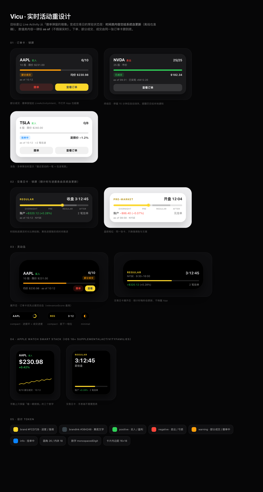

# Vicu 实时活动（Live Activities）重设计方案

- 版本：v1 草案
- 日期：2026-11-26
- 涉及模块：`Services/LiveActivities/`、`Widgets/`、`App/AppModel`、`Features/Orders`、`Features/Trade`、`Features/Settings`
- 配套视觉稿：`docs/live-activities-redesign-mockup.png`（可交互版：`docs/live-activities-redesign-mockup.html`）

---

## 0. 一页结论

**现状**：Live Activity 只服务于「撤单确认」这一个弹窗——用户在 App 内、弹窗已经打开的情况下才创建，2 分钟内就消失。它本质上是一块**弹窗的镜像**，从来不会出现在用户真正会看它的地方（锁屏、灵动岛、表盘）。所以「利用率低」不是样式问题，而是**场景选错了**。

**方案**：把 Live Activity 从「某个操作的回执」升级为 **Vicu 的交易日常驻状态层**，用三张卡覆盖三类注意力：

| 卡 | 解决的问题 | 何时出现 | 无服务端也能准确吗 |
|---|---|---|---|
| **交易日卡 Session** | 「现在是什么时段、还有多久收盘 / 开盘」 | 用户打开 App 且当日有交易时段时 | ✅ 时间自更新，完全准确 |
| **订单卡 Order** | 「我那笔单现在怎么样了」 | 下单 / 部分成交 / 撤单 / 成交时 | ⚠️ App 运行时准确，之后靠时间与「as of」表达陈旧 |
| **盯盘卡 Pin** | 「我刚买的那只现在多少」 | 用户主动 pin 一只标的 / 一个持仓 | ⚠️ 同上，仅前台实时 |

**关键设计原则**（后文所有细节都从这四条推导）：

1. **不骗人**：没有服务端推送就永远没有后台实时价。所有数字都带「as of」；过期用系统陈旧态 + 明确视觉，而不是假装实时。
2. **能不更新就不更新**：凡是可以交给系统自更新的内容（倒计时、进度条），一律用 `Text(timerInterval:)` / `ProgressView(timerInterval:)`，让卡片几小时不更新也准确。
3. **单一写入口**：所有 `request/update/end` 只能经过一个 coordinator；UI 不再直接调 ActivityKit。
4. **Widget 不含文案**：所有可见文案由 App 侧按当前语言生成后写入 `ContentState`，顺带修掉现在「中文界面下锁屏显示 Confirm/Sending」的缺陷。

**成本估算**：约 4–5 人日，分 5 个阶段（见 §6），每阶段可独立上线、独立验收。

---

## 1. 现状审计

### 1.1 现有实现

| 组件 | 位置 | 内容 |
|---|---|---|
| 属性模型 | `Services/LiveActivities/OrderActivityAttributes.swift` | 1 个 `ActivityAttributes`：`orderID / symbol / side / quantityText / orderType`，状态是 `phase + message + updatedAt` |
| 生命周期管理 | `Services/LiveActivities/OrderActivityManager.swift` | 静态 `enum`，5 个方法，按 `orderID` 找活动后 `update` 或 `end` |
| Widget | `Widgets/OrderLiveActivityWidget.swift` | 锁屏 HStack + 灵动岛 expanded/compact/minimal，文案硬编码英文 |
| 触发点 | `Features/Orders/OrdersView.swift:149 / 156 / 123 / 131` | 仅撤单 sheet 的 present / dismiss / confirm / 成功失败 |

### 1.2 为什么利用率低（六个具体原因）

1. **时机反了**：活动在用户「已经盯着弹窗」时创建，信息增量为零；真正需要它的时刻（离屏、锁机、开会）它不存在。
2. **生命周期太短**：`staleDate` 固定 `now+120s`，成功后 `dismissalPolicy .after(now+300s)`，失败/取消立即结束。用户几乎不可能在锁屏上遇到它。
3. **只有「撤单」一条链路**：下单、受理、部分成交、成交、拒单、改价、到期——订单生命周期最有价值的 90% 完全没有卡片。
4. **没有自更新内容**：全部是 App 推过去的静态字符串，App 一挂起，卡片就是一张冻住的截图。
5. **不可交互、不可深链**：没有 `Button(intent:)`、没有 `widgetURL`，点开只会回到 App 首页。
6. **多张活动互相打架**：每笔订单各自一张卡，`relevanceScore` 未设置；同时撤两单就会出现两张几乎一样的卡，灵动岛按创建顺序抢占。

### 1.3 顺带发现的缺陷（重设计一并解决）

| # | 缺陷 | 证据 |
|---|---|---|
| 1 | Widget 文案写死英文，中文界面下锁屏仍是 `Confirm / Sending / Sent` | `OrderLiveActivityWidget.swift:123-135` |
| 2 | Widget target 没有任何本地化资源，`.xcstrings` 只属于 App target | `project.pbxproj` Sources 阶段仅 2 个文件 |
| 3 | 4 条文案在语言目录里是 `extractionState: stale` | `Resources/Localizable.xcstrings` 中 `orders.live_activity.*` |
| 4 | 启动时不清理孤儿活动：等待确认时杀进程 → 锁屏残留一张「Confirm」 | 无 `Activity.activities` 协调逻辑 |
| 5 | 撤单请求被交易所拒绝时卡片已结束，无法反映 `order_cancel_rejected` | `endCancellation` 在 HTTP 200 后立即 `end` |
| 6 | 无设置项、无系统授权状态提示、无测试 | `NotificationSettingsView` 无相关 Section；`vicuTests` 无覆盖 |

---

## 2. 平台约束（决定了设计边界）

这些是硬约束，方案必须顺着它们设计，而不是对抗：

| 约束 | 含义 | 对设计的影响 |
|---|---|---|
| **没有服务端 / 没有 APNs** | App 被挂起后无法 `update` 活动（ActivityKit push 需要服务器） | 数值型内容必然过期；只能用「时间自更新 + as-of + 陈旧态」表达 |
| **`Text(timerInterval:)` / `ProgressView(timerInterval:)`**（iOS 16+，已在 SDK 确认） | 系统自己刷新文本/进度，不需要 App 唤醒 | 时段倒计时、当日进度可以**零更新**保持准确 |
| **`ContentState` ≤ 4 KB** | 单次更新载荷上限 | 状态只放展示值，不放原始 JSON |
| **`relevanceScore`** | 多张活动时的排序，最大者进灵动岛 | 订单卡 > 盯盘卡 > 交易日卡 |
| **灵动岛同时展示 2 张**（Apple 文档举 iPhone 18 Pro 为例） | 超出部分堆叠在锁屏 | 设计按「最多 2 张同时存在」收敛 |
| **`LiveActivityIntent`**（iOS 17+） | 可在 App 后台运行时由 intent 启动/更新活动 | 撤单按钮可以在不打开 App 的情况下执行 |
| **`style: .transient`**（iOS 18） | 只在灵动岛展开态短暂出现，锁屏/收起/离开 App 即结束 | **不适合**订单跟踪；本方案不使用 |
| **`update(content, alertConfiguration:)`**（iOS 26） | 重要更新可以触发提示（Watch 用 title/body） | 成交收尾可选，但默认交给本地通知 |
| **`supplementalActivityFamilies([.small])`**（iOS 18，已在 SDK 确认） | 同一活动可出现在 Apple Watch Smart Stack | 低成本拿到手表端，值得做 |
| **`NSSupportsLiveActivitiesFrequentUpdates`** | 声明可高频更新（否则系统收紧预算） | 仅在盯盘卡做行情 tick 时才需要 |

> 结论：**「后台实时」这件事本项目做不到**，除非引入中继服务（把用户 API Key 交给第三方，属于产品级决策，不在本方案内）。所以本方案的价值主张不是「实时」，而是**「随手一眼就知道现在该关心什么」**。

---

## 3. 产品设计

### 3.1 交易日卡 Session（新增，默认开启）

**一句话**：把「今天美股什么时段、还有多久切换」做成一块永远准确的时间仪表。

- **数据**：`MarketOverview.clock` + `calendar` + `overnightCalendar` → 复用已有的 `MarketSessionSchedule.intervals(from:overnightDays:)`，得到当天四段（overnight / preMarket / regular / afterHours）的起止时间。
- **自更新**：相位名 + 下一相位倒计时（`Text(timerInterval: phaseEnd...)`）+ 全天进度（`ProgressView(timerInterval: dayStart...dayEnd)`），**App 不唤醒也准确**。
- **有信息量的附加值**：最近一次已知的账户日内盈亏 + 挂单数量，全部标 `as of HH:mm`。
- **生命周期**：当日第一个时段开始 → 当日最后一个时段结束后 5 分钟结束；`staleDate = 下一相位切换时刻 + 5 分钟`。
- **为什么这条最能提升「利用率」**：它是唯一**在完全离线状态下也不会说假话**的内容，而且每天都能用上；一张卡就能让用户形成「锁屏上有 Vicu」的习惯。

### 3.2 订单卡 Order（重构，替代现有撤单卡）

**一句话**：从「点了下单」到「成交/拒单」的整条生命周期，一张卡跟到底。

- **创建**：`AppModel.submit` 成功合并订单时（`AppModel+Portfolio.swift:436`）、`closePosition`、`replaceOrderPrice` 之后。
- **状态机**（见 §5.3）：`submitted → accepted → partiallyFilled* → filled | canceled | rejected | expired | replaced`，并含 `cancelRequested` 中间态。
- **信息层次**：标的 + 方向 → 数量/类型/限价 → 成交进度（`ProgressView(value:)` + `6/10`）→ 均价 / 状态 / `as of`。
- **交互**：
  - 「撤单」按钮 → `LiveActivityIntent`，直接在 App 进程里调 Alpaca cancel，卡片立刻变 `cancelRequested`，失败则回滚并展示原因。
  - 「查看」→ 深链到订单详情（见 §5.7）。
- **多单聚合**：**同时只保留一张**订单卡。若有多笔在途订单，卡片显示「最近变动的一笔 + `+2 more`」，用 `relevanceScore` 保证它在灵动岛优先。这样避免锁屏被同质卡片刷屏。
- **收尾**：终结态停留 15 分钟后 `dismissPolicy .after(...)` 自动消失；成交同时仍走现有本地通知（不重复造一套提醒）。

### 3.3 盯盘卡 Pin（新增，可选阶段）

**一句话**：用户主动把一只标的钉在锁屏上。

- **入口**：`AssetDetail` / `PositionDetail` 的「钉到锁屏」按钮（也可长按菜单）。
- **内容**：现价 + 日涨跌 + 持仓浮动盈亏（若有持仓）+ 60 点迷你走势（`Canvas`）。
- **数据**：前台时由 `AlpacaStockStreamClient` 推送驱动；后台不更新，`staleDate = now+3min`，超过即显示「as of」并变灰。
- **生命周期**：收盘后 30 分钟自动结束；与订单卡互斥（同时只能有一张「个人关注」卡）。
- **诚实性要求**：这张卡最容易变成「假实时」。必须默认显示时间戳，陈旧时把价格降级为 secondary 色，且不做「跳动」动画暗示。

### 3.4 生命周期矩阵

| 事件 | Session | Order | Pin |
|---|---|---|---|
| App 首次前台（有凭证） | 当日有活动时段 → 创建/接管 | 接管遗留卡并校正状态 | 接管 |
| 下单成功 | 不变 | 创建或切换主卡 | — |
| trade_updates 事件 | 不变 | update（节流 1s） | — |
| 30s 账户轮询 | update 盈亏/挂单数 | update（兜底对齐） | — |
| 进入后台 | 不变（靠时间自更新） | 不变 | 不变 |
| 相位切换 | 下一次前台时 update | — | — |
| 当日时段结束 | `end(.after(+5min))` | — | `end(.after(+30min))` |
| 订单终结 | — | `end(.after(+15min))` | — |
| 用户关闭开关 | `end(.immediate)` | `end(.immediate)` | `end(.immediate)` |
| 切换环境（live/paper） | 全部 `end` 后按新环境重建 | 同左 | 同左 |
| 启动时发现孤儿 | 无对应当日时段 → 结束 | 订单已终结/查不到 → 结束 | 无 pin 记录 → 结束 |

### 3.5 明确不做

- ❌ **不做「成交弹窗」的 Live Activity 复刻**——那是本地通知的职责，两套并行只会互相削弱。
- ❌ **不做行情 ticker 卡**（无推送 + 更新预算双重不成立）。
- ❌ **不做 `style: .transient`**：它随用户离开 App 即结束，与「离屏可见」的目标相反。
- ❌ **不做多张订单卡并列**：灵动岛只有 2 个位置，聚合比堆叠有效。

---

## 4. 视觉与交互规格

> 视觉稿：
>
> 也可用浏览器打开可交互版本：`docs/live-activities-redesign-mockup.html`（含明暗两套 + 灵动岛三态 + 手表尺寸）

### 4.1 锁屏卡（Order，深色 / 英文示例）

```
┌──────────────────────────────────────────────┐
│  AAPL  BUY                         6/10      │
│  10 sh · LIMIT $231.00                       │
│  ▓▓▓▓▓▓▓▓▓▓▓▓░░░░░░░░░░░░░░░░░░░░░░░░░░░░░░  │
│  PARTIALLY FILLED        avg $230.98         │
│  as of 10:12                                 │
│  ┌──────────────┐        ┌──────────────┐    │
│  │  撤单        │        │  查看        │    │
│  └──────────────┘        └──────────────┘    │
└──────────────────────────────────────────────┘
```

### 4.2 锁屏卡（Session，浅色 / 中文示例）

```
┌──────────────────────────────────────────────┐
│  REGULAR                       收盘 3:12:45  │
│  ▓▓▓▓▓▓▓▓▓▓▓▓▓▓▓▓▓░░░░░░░░░░░░░░░░░░░░░░░░   │
│  Overnight ├─Pre─┼─── Regular ───┼─ After ─┤ │
│  账户 +$320.12 (+0.28%)        2 笔挂单      │
│  as of 10:12 · NYSE                          │
└──────────────────────────────────────────────┘
```

### 4.3 灵动岛

| 形态 | Order 卡 | Session 卡 |
|---|---|---|
| expanded leading | 代码 + 方向 | 相位名 |
| expanded trailing | 状态胶囊 + `6/10` | 倒计时（自更新） |
| expanded bottom | 进度条 + 均价 + 两个按钮 | 全天进度 + 账户摘要 |
| compact leading | 代码缩写（4 字符） | 相位图标 |
| compact trailing | 成交进度环 | 距下一相位剩余分钟 |
| minimal | 状态字形 | 相位字形 |

> compact 侧必须保持「一眼可读」：不用图表、不用长数字。

### 4.4 设计 token

| Token | 值 | 用途 |
|---|---|---|
| `brand` | `#FCD72B`（现有 `AppTheme.ColorToken.brand`） | 进度条、关键强调、当日走势 |
| `surface` | 深色 `rgba(28,28,30,0.94)` / 浅色 `#FFFFFF` | 卡片底色（iOS 26 交给系统玻璃，不强制 tint） |
| `positive / negative` | `.green` / `.red` | 盈亏、买卖方向 |
| `warning` | `.orange` | 部分成交、撤单中 |
| 圆角 | 26（锁屏卡）、18（内部块） | 与 `AppTheme.CornerRadius.groupedSurface` 对齐 |
| 数字 | `.monospacedDigit()`，与 `AppTypography.rowValue` 一致 | 价格/数量/倒计时 |
| 间距 | 外边距 16、行间 6/10 | 与现有 widget 一致 |

**状态语义表**（颜色 + 图标 + 文案三者同时编码，不依赖颜色单通道）：

| 状态 | 图标 | 颜色 | 文案（zh / en） |
|---|---|---|---|
| submitted | `paperplane.fill` | secondary | 已提交 / Submitted |
| accepted | `clock.fill` | blue | 挂单中 / Working |
| partiallyFilled | `circle.lefthalf.filled` | orange | 部分成交 / Partially filled |
| cancelRequested | `hourglass` | orange | 撤单中 / Canceling |
| filled | `checkmark.circle.fill` | green | 已成交 / Filled |
| canceled | `xmark.circle.fill` | secondary | 已撤销 / Canceled |
| rejected | `exclamationmark.triangle.fill` | red | 被拒绝 / Rejected |
| expired | `clock.badge.xmark` | secondary | 已过期 / Expired |

### 4.5 可访问性

- 整卡 `.accessibilityElement(children: .combine)` + 一条完整 `accessibilityLabel`（「AAPL 买入 10 股 限价 231 美元，部分成交 6 股，均价 230.98，10:12 更新」）。
- 进度条给 `.accessibilityValue("6/10")`。
- 倒计时不要每秒播报：`timerInterval` 文本加 `.accessibilityLabel` 静态摘要。
- 对比度：品牌黄上不放白字（用 `AppTheme.ColorToken.brandForeground`，≈ `#384248`）。

### 4.6 文案与本地化策略

**规则：Widget 里不出现任何写死的用户可见字符串。**

- App 侧按 `appLanguage` 生成 `title / subtitle / detail / actionTitle / asOf` 等字段，写入 `ContentState`。
- Widget 只负责排版 + SF Symbols + 数字格式化结果。
- 好处：① 与 App 内语言 100% 一致（Widget 读不到 `appLanguage`）；② Widget target 不需要加 `.xcstrings` 资源；③ 预览/测试可以用固定 state 完整渲染。
- 同时清理 `Localizable.xcstrings` 中 4 条 `extractionState: stale` 的旧键，换成新的 `live_activity.*` 命名空间（en / zh-Hans 双语）。

---

## 5. 技术方案

### 5.1 目录结构

```
Services/LiveActivities/
  LiveActivityModels.swift        // 三个 Attributes + ContentState + 相位枚举（App + Widget 双 target）
  LiveActivityClient.swift        // 协议 + ActivityKit 实现（App only，便于测试替身）
  LiveActivityCoordinator.swift   // 唯一写入口：协调 / 合并 / 节流 / 孤儿清理（App only）
  LiveActivityPolicy.swift        // 何时建/何时结束/staleDate/开关（App only，纯函数）
  LiveActivityIntents.swift       // CancelOrderIntent（App + Widget 双 target）
  LiveActivityPresentation.swift  // 领域模型 → ContentState（本地化文案在这里生成）
Widgets/
  VicuLiveActivitiesBundle.swift  // WidgetBundle（替换现有 @main）
  OrderActivityWidget.swift
  SessionActivityWidget.swift
  PinActivityWidget.swift
  Components/ActivityCardChrome.swift  // 共享底色/圆角/状态胶囊/进度条/迷你走势
```

> 注意：工程用的是显式文件引用的 `project.pbxproj`（objectVersion 60，无 synchronized group），新增文件必须手动登记 PBXFileReference / PBXBuildFile / 两个 target 的 Sources。因此**刻意把文件数控制在 ~6 新增 + 2 改写**，避免工程文件大面积抖动。

### 5.2 单一写入口

```
UI / 事件源 ──► LiveActivityCoordinator ──► LiveActivityClient ──► ActivityKit
                 (只此一处 request/update/end)
```

```swift
@MainActor
final class LiveActivityCoordinator {
    func bootstrap() async                                  // 前台启动：reconcile + adopt + 按需重建
    func handleScenePhase(_ phase: ScenePhase) async        // 回前台刷新快照；进后台只更新时间戳
    func ordersChanged(_ orders: [AlpacaOrder])             // 订单列表/轮询
    func tradeEventReceived(_ event: AlpacaTradeEvent)       // 实时流
    func marketSnapshotChanged(_ snapshot: MarketSnapshot)   // clock + calendar + account 摘要
    func pinChanged(_ symbol: String?)                       // 主动盯盘
    func settingsChanged() / func endAll(reason:) async
}
```

职责边界：
- **Coordinator** 拥有「哪张卡该存在」的判断权；UI 只表达意图（下单了 / 撤单了 / pin 这只）。
- **Policy** 是无副作用的纯函数：`policy(for: state, now:, session:) -> DesiredActivity`，方便单测。
- **Client** 是 ActivityKit 的薄封装：`request / update / end / list`，测试用 `FakeLiveActivityClient` 断言调用序列。

### 5.3 状态机

**Order**（映射自 Alpaca `status`）：

```
submitted ─┬─► accepted ─┬─► partiallyFilled* ─┬─► filled
           │             │                     ├─► canceled
           │             │                     └─► expired
           │             ├─► pendingCancel ───► canceled   (被拒时回滚 accepted)
           │             └─► replaced ────────► 新订单接管同一张卡
           ├─► rejected
           └─► canceled
```

- `AlpacaOrder.status` 取值：`new / accepted / pending_new / partially_filled / filled / done_for_day / canceled / expired / replaced / pending_cancel / pending_replace / stopped / rejected / suspended / calculated`。
- 终结态判定集中在一个 `var isTerminal: Bool`，避免散落各处 `status == "filled"`。
- 部分成交的均价优先取 `filled_avg_price`，缺失时用 trade event 的 `price`，再缺失回退 `limit_price`。

**Session**：

```
overnight ─► preMarket ─► regular ─► afterHours ─► (结束)
```

- 由 `MarketSessionSchedule.intervals` 直接给出，不在 Widget 里计算。
- 相位切换不依赖 App 唤醒：卡片的倒计时/进度条按时间自更新；相位名在下次前台或 `staleDate` 触发陈旧态时校正。

**Pin**：`pinned(symbol)` → `stale` → `ended(afterClose)`。

### 5.4 数据来源与新鲜度

| 数据 | 来源 | 前台 | 后台 | 表达 |
|---|---|---|---|---|
| 时段起止 | `MarketOverview.calendar` + `clock` | 准确 | 不变 | 时间自更新，永远准确 |
| 当日账户盈亏 | `AlpacaAccount.equity - last_equity` | 30s 轮询刷新 | 冻结 | `as of HH:mm` |
| 挂单数量 | `portfolio.orders` | 实时流 + 轮询 | 冻结 | 数字 + as-of |
| 订单状态 | trade_updates WS / 订单轮询 | 秒级 | 冻结 | 陈旧态 + as-of |
| 标的现价 | `AlpacaStockStreamClient` | tick 级（节流） | 冻结 | 3 分钟后 stale |

### 5.5 节流、合并、去重

- **内容哈希**：`ContentState` 生成后取 `hashValue`（或自建稳定签名），相同则跳过 `update`——这是省预算最有效的一招。
- **最小间隔**：同一活动的两次 `update` 间隔 ≥ 1.0s；连续事件用 0.3s debounce 合并（部分成交常常连发 3–5 条）。
- **兜底对齐**：每 30s 轮询触发一次「若与当前 state 不一致则 update」。
- **预算意识**：只在订单事件时更新，不做行情 tick；因此**暂不申请** `NSSupportsLiveActivitiesFrequentUpdates`，留到盯盘卡上线再评估。

### 5.6 启动协调与孤儿清理

```swift
for activity in Activity<OrderActivityAttributes>.activities {
    guard let order = ordersByID[activity.attributes.orderID] else { end(.immediate); continue }
    if order.isTerminal, activity.content.state.isTerminal == false { update(terminal); end(.after(+15m)) }
    else { adopt(activity) }   // 纳入 coordinator 管理，避免重复 request
}
```

- 同样处理 Session（当日无对应时段 → 结束）与 Pin（无 pin 记录 → 结束）。
- 这条逻辑同时解决「等待确认时杀进程 → 锁屏残留」的现有缺陷。

### 5.7 交互与深链

- **撤单按钮**：`struct CancelOrderIntent: LiveActivityIntent`，`perform()` 内读 Keychain 凭证（App 进程同 sandbox）、调 `AlpacaClient.cancelOrder`、更新活动状态；失败时把活动回滚到原状态并附带错误短文案。
  - 需同时加入 App 与 Widget 两个 target（Widget 侧仅为渲染按钮，执行在 App 进程）。
- **查看订单**：两种实现，二选一（见 §8 决策 3）：
  - **A. 深链**：注册 `vicu` URL scheme，`widgetURL(URL(string: "vicu://order/<id>"))`，App 的 `onOpenURL` 写入 `pendingOrderDetailRequest`（现成机制，见 `AppModel+Navigation`）。
  - **B. 无 URL**：按钮用 `OpenIntent`（`openAppWhenRun = true`）带订单 id 打开 App。不需要改 Info.plist，但只能作为按钮，卡片本体点击仍回首页。
- 深链需要把 App target 从「自动生成 Info.plist」改为「手写 Info.plist」（`GENERATE_INFOPLIST_FILE=NO`），顺带为后续 `BGTaskSchedulerPermittedIdentifiers` 留位置。

### 5.8 设置与授权

- `AppConfigurationKeys.LiveActivities`：`isEnabled` / `sessionCardEnabled` / `orderCardEnabled` / `pinEnabled`。
- 在 `Features/Notifications/NotificationSettingsView.swift` 新增 Section「锁屏实时活动」，每项一个 Toggle，底部说明「后台不会实时更新，卡片会显示更新时间」。
- 当 `ActivityAuthorizationInfo().areActivitiesEnabled == false`：Section 顶部显示提示 + 跳转系统设置；订阅 `activityEnablementUpdates` 实时响应。

### 5.9 测试策略

| 层级 | 内容 |
|---|---|
| 纯函数单测 | 所有 Alpaca 状态 → 相位；部分成交均价回退顺序；终结态判定；多单选主规则 |
| Session 单测 | 用固定 calendar fixture 覆盖：常规日、半日市、节假日、隔夜时段边界、DST 切换 |
| Coordinator 单测 | `FakeLiveActivityClient` 断言：首次创建、重复事件只 update 一次、终结后 `end(.after)`、启动时孤儿被清理、开关关闭时全部结束 |
| 呈现层 | `#Preview` 覆盖 8 个状态 × 明暗 × 三种形态，作为视觉回归基线 |
| 真机 | 物理设备安装 + 锁屏/灵动岛/手表实机截图（见 AGENTS.md 要求） |

---

## 6. 分阶段实施

| 阶段 | 内容 | 交付物 | 验收标准 | 预估 |
|---|---|---|---|---|
| **P0 地基** | 新模型 + Client 协议 + Coordinator + Policy；移除 `OrderActivityManager`；Widget 文案改为 state 驱动（先只做订单卡） | 6 个文件、现有撤单链路改走 coordinator | 现有撤单体验不回退；中文界面锁屏全中文；杀进程后无残留 | 1 天 |
| **P1 订单卡** | 下单/改价/平仓触发；trade_updates 驱动；多单聚合；撤单按钮（Intent）；深链到订单详情 | Order 卡完整版 | 下单→成交全程一张卡；锁屏可一键撤单；点击直达订单详情 | 1–1.5 天 |
| **P2 交易日卡** | 时段模型接入；自更新倒计时/进度条；账户摘要；设置开关 | Session 卡 | 卡片挂机 4 小时仍分秒准确；相位切换正确；半日市/节假日正确 | 1 天 |
| **P3 盯盘卡**（可选） | Pin 入口；流式报价节流；迷你走势；收盘自动结束 | Pin 卡 | 前台价格跟手不卡顿；后台 3 分钟后明确降级；不误报实时 | 1–1.5 天 |
| **P4 打磨** | Apple Watch `supplementalActivityFamilies`；可访问性；明暗与 iOS 26 玻璃适配；截图与 README | 文档 + 截图 | 手表 Smart Stack 可见；VoiceOver 通读完整 | 0.5 天 |

**建议节奏**：P0 + P1 一次上线（这是「利用率」的主要来源），P2 紧随（成本最低、天天可见），P3 视反馈决定。

---

## 7. 风险与对策

| 风险 | 影响 | 对策 |
|---|---|---|
| **后台无更新**导致卡片「看起来实时其实过期」 | 用户误判价格/状态，金融场景下是硬伤 | 全字段 as-of；`staleDate` 收紧；陈旧态视觉降级；文案明说「后台不刷新」 |
| 活动数量超限 / 灵动岛争抢 | 重要卡片被挤掉 | 同时最多 2 张；`relevanceScore` 显式排序；多单聚合 |
| ActivityKit 更新预算被系统收紧 | 更新延迟或丢弃 | 内容哈希去重 + 1s 节流；不申请 frequent updates |
| 4 KB 状态上限 | 大列表/长文本超限 | state 只放展示值；迷你走势用 60 点以内的定点数组 |
| `LiveActivityIntent` 需要两份 target 成员 | 漏加导致按钮无响应 | P0 就把 intent 文件加入双 target 并加真机冒烟用例 |
| 手改 `project.pbxproj` | 工程文件损坏 | 一次只加一组文件，改完立即 `xcodebuild -list` 校验 |
| 无服务端 = 天花板明确 | 用户期待「像外卖一样实时」 | 在设置页与文档中明确边界，不做过度承诺 |

---

## 8. 待决策（附推荐）

1. **交易日卡是否默认开启？**
   推荐：**默认开启**，设置可关。理由：它是唯一离线准确的内容，也是「锁屏上有 Vicu」习惯的载体。

2. **是否做盯盘卡（P3）？**
   推荐：**先不做**，P1/P2 上线观察一周再定。盯盘卡最容易产生「假实时」投诉，收益/风险比最差。

3. **订单卡深链用哪种方案？**
   推荐：**A（注册 `vicu` scheme + 手写 Info.plist）**。多花半天，换来卡片本体可点、后续后台刷新也能复用。

4. **是否引入后台机会刷新（`BGAppRefreshTask`）？**
   推荐：**暂不引入**。它不保证执行时机（一天几次），却要在 App Review 里解释后台用途；P2 结束后若确有需要再评估。

5. **多单聚合的「代表单」规则？**
   推荐：**最近发生状态变化的那笔**（而不是最新下单的），这样卡片永远显示「刚刚动了的那单」。

---

## 附录 A · 改动清单（文件 → 动作）

| 文件 | 动作 |
|---|---|
| `Services/LiveActivities/LiveActivityModels.swift` | 新增：三个 `ActivityAttributes` + `ContentState` + 相位枚举（双 target） |
| `Services/LiveActivities/LiveActivityClient.swift` | 新增：ActivityKit 薄封装协议 + 真实实现（App） |
| `Services/LiveActivities/LiveActivityCoordinator.swift` | 新增：唯一写入口（App） |
| `Services/LiveActivities/LiveActivityPolicy.swift` | 新增：纯函数策略（App） |
| `Services/LiveActivities/LiveActivityPresentation.swift` | 新增：领域模型 → 本地化 `ContentState`（App） |
| `Services/LiveActivities/LiveActivityIntents.swift` | 新增：`CancelOrderIntent`（双 target） |
| `Services/LiveActivities/OrderActivityAttributes.swift` | 迁移进 `LiveActivityModels.swift` 后删除 |
| `Services/LiveActivities/OrderActivityManager.swift` | 删除，能力并入 Coordinator |
| `Widgets/VicuLiveActivitiesBundle.swift` | 新增：`@main` WidgetBundle（取代现文件里的 `@main`） |
| `Widgets/OrderActivityWidget.swift` | 重写现有 `OrderLiveActivityWidget.swift` |
| `Widgets/SessionActivityWidget.swift` | 新增 |
| `Widgets/Components/ActivityCardChrome.swift` | 新增：共享底色/状态胶囊/进度条/时段轨 |
| `Features/Orders/OrdersView.swift` | 删除 4 处直接调用（撤单意图改由 `AppModel.cancelOrder` 内部上报，UI 无感） |
| `App/AppModel/AppModel+Portfolio.swift` | `submit` / `cancelOrder` / `replaceOrderPrice` / `closePosition` 后上报 coordinator |
| `App/AppModel.swift` | 持有 coordinator，`bootstrap` 时调用 `liveActivities.bootstrap()` |
| `App/VicuApp.swift` | 转发 `scenePhase`；若选深链方案则加 `onOpenURL` |
| `Services/Realtime/RealtimeEventCoordinator.swift` | `handleTradeEvent` 后转发给 coordinator |
| `Features/Notifications/NotificationSettingsView.swift` | 新增「锁屏实时活动」Section |
| `Models/Caching/AppModelCacheKeys.swift` | 新增 `AppConfigurationKeys.LiveActivities.*` |
| `Resources/Localizable.xcstrings` | 删除 4 条 stale 旧键，新增 `live_activity.*`（en / zh-Hans） |
| `vicu.xcodeproj/project.pbxproj` | 登记新文件 + 双 target 成员；若选深链则切换手写 Info.plist |
| `vicuTests/LiveActivityTests.swift` | 新增：状态机 / 时段 / coordinator 三组单测 |

> 建议按此顺序施工：先是纯模型 + 策略 + 测试（不碰 ActivityKit），再接 Widget，最后接 UI 触发点——每一步都能单独编译通过。
